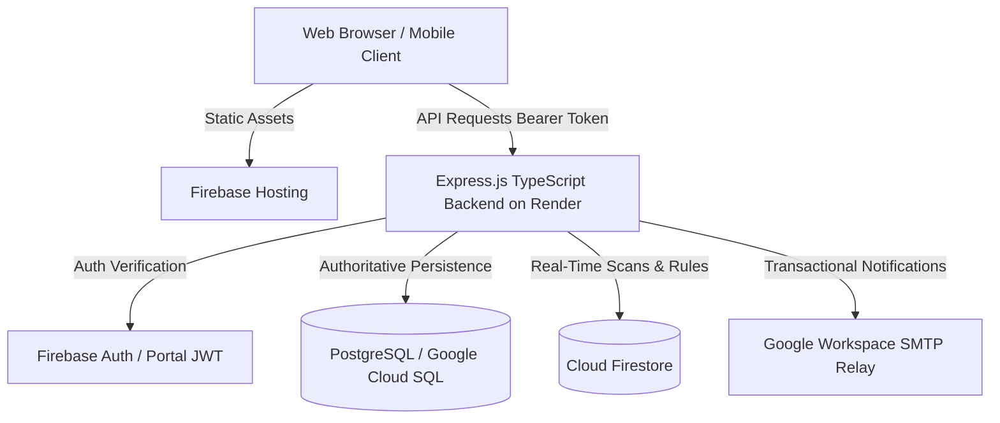

# Swami Rama Himalayan University (SRHU) Attendance & Examination Portal

An institutional-grade, multi-role academic management, attendance tracking, and examination portal designed for Swami Rama Himalayan University (SRHU). Built with Node.js 20, TypeScript, Express, PostgreSQL (Cloud SQL), Firebase Authentication, and a responsive frontend adhering strictly to the SRHU institutional design system.

---

## 1. System Overview & Key Features

The portal serves four institutional roles: **Global Administrator**, **Head of Department (HOD)**, **Faculty / Teacher**, and **Student**, enforcing strict server-side Role-Based Access Control (RBAC) and academic department scoping.

### Core Capabilities
- **Academic Hierarchy Engine:** Configurable database-backed schools (e.g. School of Science and Technology, School of Bioscience, School of Management), departments, programmes, semesters, sections, and practical subgroups (e.g. C1, C2).
- **Dual Institutional Identifiers:** Independent validation and storage for both **Enrollment Numbers** (e.g. `SRHU/2026/001`) and **Registration Numbers** (e.g. `REG2026101`), preserving exact casing and leading zeros.
- **Attendance Integrity:** 
  - Institutional calculation: $\text{Rate} = \frac{\text{Present}}{\text{Present} + \text{Absent}} \times 100$.
  - Approved Leave ($\text{L}$) strictly excluded from both numerator and denominator.
  - Safe zero-denominator handling returning an explicit unavailable status (`N/A` / `null`) without fabricating numbers.
  - Idempotent session opening and duplicate attendance record prevention.
- **Live Rotating QR-Code Attendance:** Rotating HMAC-SHA256 session tokens with 20-second validity windows, geo-proximity verification, 6-digit numeric backup challenge codes, and anti-replay protection.
- **Timetable & Conflict Engine:** Validates interval boundaries ($\text{start} < \text{end}$), detects teacher and classroom overlaps, and preserves valid parallel practical lab sessions.
- **Two-Stage Bulk Onboarding:** Spreadsheet parser supporting XLSX/CSV with spreadsheet formula injection protection (neutralizing `=`, `+`, `-`, `@`), duplicate detection, preview before commit, and 48-hour single-use cryptographic invitation tokens.
- **Examination & Continuous Internal Assessment (CIA):** Component-based marks entry, status lifecycles (`DRAFT` $\to$ `SUBMITTED` $\to$ `PUBLISHED`), and student privacy isolation.
- **Cryptographic Audit Trail:** Linear sequential SHA-256 hash-chained audit logging ($H_i = \text{SHA-256}(H_{i-1} \parallel \text{payload}_i)$) with real-time tamper-detection verification.
- **Security & Session Management:** Server-side idle timeouts (15 minutes), absolute session expiration (8 hours), device session tracking, and instant account suspension propagation.

---

## 2. Architecture & Technology Stack



- **Frontend:** Semantic HTML5, Vanilla JavaScript, CSS3 with SRHU Institutional Blue brand token (`#1D3C72`), hosted on **Firebase Hosting**.
- **Backend:** Node.js 20+, Express 4.x, TypeScript 5.x, hosted on **Render** (or Google Cloud Run).
- **Authoritative Database:** PostgreSQL 15+ with transaction-local Row-Level Security (`SET LOCAL`), strict foreign keys, and linear hash chain audit triggers.
- **Authentication:** Firebase Authentication (client ID tokens verified on backend via Firebase Admin SDK) + Institutional HMAC-SHA256 session tokens (min 32-character secret).
- **Real-Time Layer:** Cloud Firestore with least-privilege security rules.

---

## 3. Directory Structure

```text
├── index.html                   # University landing portal
├── signin.html                  # Institutional authentication gateway
├── admin.html                   # Global Administrator console
├── admin-timetable.html         # Timetable planning & conflict resolution
├── admin-students.html          # Student directory & bulk onboarding
├── admin-teachers.html          # Faculty management & teaching assignments
├── admin-marks.html             # Examination & CIA marks administration
├── teacher.html                 # Faculty lecture schedule & register
├── teacher-marks.html           # Faculty grade entry console
├── student.html                 # Student attendance & timetable dashboard
├── student-marks.html           # Student published results portal
├── calendar.html                # Institutional academic calendar
├── profile.html                 # User profile & security settings
├── styles.css                   # SRHU Design System tokens & styles
├── site.js                      # Core frontend utilities & route guards
├── firebase-init.js             # Firebase client SDK initialization
├── firebase.json                # Firebase Hosting & Firestore configuration
├── firestore.rules              # Least-privilege Firestore security rules
├── render.yaml                  # Render service blueprint
├── backend/
│   ├── db/
│   │   ├── schema.sql           # Authoritative PostgreSQL DDL (20 tables + triggers)
│   │   ├── seed.sql             # Standard seed data (SST, SBS, SOM structures)
│   │   └── migrations/          # Versioned incremental migrations
│   ├── src/
│   │   ├── config/              # PostgreSQL pool & Firebase Admin SDK
│   │   ├── middleware/          # JWT/ID token authentication & RBAC guards
│   │   ├── routes/              # Express API route modules
│   │   ├── services/            # Token, audit, timetable, email, QR services
│   │   ├── tests/               # Jest unit/integration tests & verification suites
│   │   └── server.ts            # Application entry point & health probes
│   ├── package.json             # Backend dependencies & test scripts
│   └── tsconfig.json            # TypeScript configuration
├── docs/                        # Engineering audit reports & verification baselines
└── documentation/               # Product Requirements & Specifications
```

---

## 4. Prerequisites

- **Node.js:** `>= 20.0.0`
- **npm:** `>= 10.0.0`
- **PostgreSQL:** `>= 15.0` (Local instance, Google Cloud SQL, or Render PostgreSQL)
- **Google Cloud / Firebase Project:** Firebase project with Authentication & Firestore enabled.

---

## 5. Local Development Setup

### 1. Clone & Install Dependencies
```bash
# Install backend dependencies
cd backend
npm install
```

### 2. Environment Configuration
Copy `.env.example` to `.env` in the `backend/` directory:
```bash
cp .env.example .env
```

Configure the environment variables in `backend/.env`:
```ini
# PostgreSQL Database Connection
DB_HOST=127.0.0.1
DB_PORT=5432
DB_USER=postgres
DB_PASSWORD=your_local_password
DB_NAME=attendance_db
DB_SSL=false
DB_MAX_CONNECTIONS=20

# Google Cloud & Firebase Configuration
GOOGLE_CLOUD_PROJECT=attendace-d3b3e
FIREBASE_STORAGE_BUCKET=attendace-d3b3e.firebasestorage.app

# Cryptographic Session Secret (min 32 characters in production)
SESSION_SECRET=dev-session-signing-secret-srhu-portal-2026-minimum-32-chars-long

# Server Configuration
NODE_ENV=development
PORT=8080
ALLOWED_ORIGINS=http://localhost:3000,http://localhost:5000,http://localhost:8080,https://attendace-d3b3e.web.app
```

### 3. Database Initialization (Optional for Local Development)
If running a local PostgreSQL instance:
```bash
# Create database
createdb -U postgres attendance_db

# Apply schema and initial academic seed data
psql -U postgres -d attendance_db -f db/schema.sql
psql -U postgres -d attendance_db -f db/seed.sql
```
*Note: In development mode (`NODE_ENV=development`), if PostgreSQL is unavailable, the backend automatically operates in stateful in-memory fallback mode.*

### 4. Running the Development Server
```bash
# Start backend with auto-reload (binds to port 8080 and secondary port 5000)
npm run dev
```

### 5. Serving Frontend
Serve the project root with any static web server:
```bash
npx serve . -p 3000
```
Navigate to `http://localhost:3000` in your web browser.

---

## 6. Testing & Quality Verification

Run the automated test suites from the `backend/` directory:

```bash
cd backend

# Run Jest unit & integration test suites
npm test

# Run TypeScript static type checking
npx tsc --noEmit

# Run full system real-world verification
npx ts-node src/scripts/verify-full-system.ts

# Run master QA end-to-end integration suite (34 scenarios)
npx ts-node src/scripts/master-qa-e2e.ts

# Run capabilities verification (Dual IDs, Schools, Live QR)
npx ts-node src/scripts/verify-master-implementation.ts

# Run all-roles & RBAC boundary verification
npx ts-node src/tests/all_roles_verification.ts

# Run timetable conflict engine verification
npx ts-node src/tests/timetable_verification.ts
```

---

## 7. Production Build & Deployment

### Backend Build
```bash
cd backend
npm run build
```
Generates production JavaScript in `backend/dist/`.

### Deployment Architecture
1. **Frontend (Firebase Hosting):**
   ```bash
   firebase deploy --only hosting,firestore:rules
   ```
2. **Backend (Render):**
   - Connect repository to Render as a Web Service.
   - Root Directory: `backend`
   - Build Command: `npm install && npm run build`
   - Start Command: `npm start`
   - Environment Variables:
     - `NODE_ENV=production`
     - `DATABASE_URL=<your-postgresql-url>`
     - `GOOGLE_CLOUD_PROJECT=attendace-d3b3e`
     - `SESSION_SECRET=<minimum-32-character-cryptographic-secret>`
     - `ALLOWED_ORIGINS=https://attendace-d3b3e.web.app,https://attendace-d3b3e.firebaseapp.com`

---

## 8. Health & Readiness Probes

The backend exposes standardized Kubernetes/Cloud Run health probes:
- `GET /health` (`status: 'ALIVE'`) — Liveness probe verifying process responsiveness.
- `GET /ready` (`status: 'READY'`) — Readiness probe verifying active database connection. Returns HTTP 503 (`NOT_READY`) in production if PostgreSQL is disconnected.

---

## 9. Documentation Index

- [Comprehensive Engineering Audit & Report](file:///u:/attendance%20app/docs/FINAL_ENGINEERING_REPORT.md)
- [Verification Baseline & Diagnostic Log](file:///u:/attendance%20app/docs/verification-baseline.md)
- [System Architecture & Data Requirements](file:///u:/attendance%20app/documentation/06_Data_and_Architecture_Requirements.md)
- [Security, Privacy & Legal Compliance](file:///u:/attendance%20app/documentation/07_Security_Privacy_and_Legal_Readiness.md)
- [Product Requirements Document (PRD)](file:///u:/attendance%20app/documentation/02_PRD_Product_Requirements.md)
- [Software Requirements Specification (SRS)](file:///u:/attendance%20app/documentation/03_SRS_and_Acceptance_Criteria.md)
