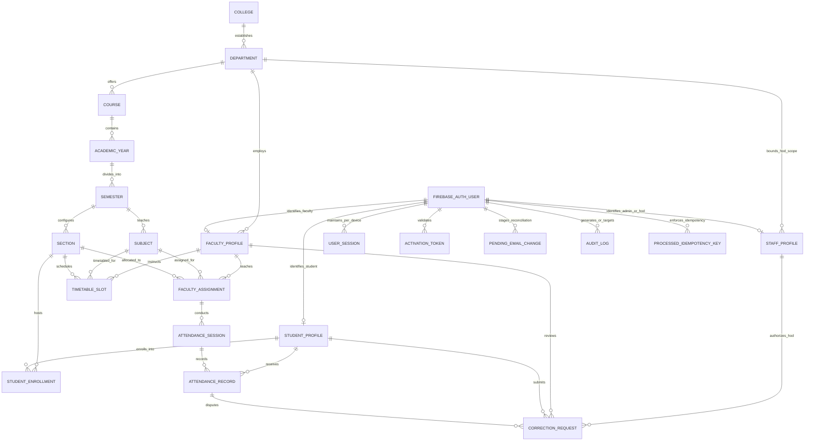

# 6. Data and Architecture Requirements

**Version:** 2.0.0 — Full Verification, Admin Operations REST API, Student Management & Two-Stage Bulk Ingest, Master Timetable Scheduler, Dual-Port Local Server & Seed In-Memory Store  
**Date:** 20 October 2026  
**Status:** Implemented & Verified in Codebase (215/215 Automated Tests Passing — 100% Pass Rate)

---

## 6.1 Academic Hierarchy and Identity Architecture

The data architecture is structured around the required 6-tier institutional hierarchy, integrated with a secure role-based identity, session management, timetable scheduling, and attendance correction lifecycle subsystem built entirely on **Google Firebase and Google Cloud Platform (GCP)**:

`College -> Department -> Course/Program -> Academic Year -> Semester -> Section -> Students`

The architecture enforces strict separation between authentication credentials (managed by **Firebase Authentication**), role-specific profile attributes, departmental scoping for HODs (enforced via server-side database checks and PostgreSQL Row-Level Security), academic curriculum definitions, enrollment progression, granular per-device session state management, and immutable attendance registers.

**Technology Mandate:** All data persistence, serverless compute, background queueing, and media storage are hosted exclusively on Google Cloud Platform and Firebase. AWS services are strictly excluded.



---

## 6.2 Database Architecture Evaluation: Cloud Firestore vs. Relational Google Cloud Options

A comprehensive evaluation was performed to determine the optimal Google-supported database architecture for managing **4,165+ students**, **~55 to 70 active class sections**, and **~1.125 million attendance marks per semester** (scaling to **10,000+ students** and **~9 million historical records**).

### A. Comparative Database Analysis

| Architectural Dimension | Cloud Firestore (Google NoSQL Document DB) | Firebase Data Connect (Cloud SQL for PostgreSQL) | Direct Cloud SQL for PostgreSQL |
| :--- | :--- | :--- | :--- |
| **Data Model Fit** | Document & Collection model. Relational joins must be simulated via client-side queries or denormalization. | **Native Relational:** PostgreSQL engine. Strict relational integrity, foreign keys, and multi-table joins. | **Native Relational:** Standard PostgreSQL engine with complete SQL DDL/DML control. |
| **6-Tier Academic Hierarchy Integrity** | Cannot enforce composite foreign key constraints across College $\rightarrow$ Course $\rightarrow$ Year $\rightarrow$ Semester $\rightarrow$ Section. Dependent on code validation. | **Native Database Integrity:** Foreign keys, composite unique constraints (`session_id, student_id`), and cascade rules enforced at database level. | **Native Database Integrity:** Standard SQL constraints, triggers, and foreign keys. |
| **Attendance Aggregation Performance** | Calculating `Present / (Present + Absent)` across 1.125M records requires either reading thousands of documents per query or maintaining distributed counters (prone to race conditions). | **Measurable Query SLAs:** Native PostgreSQL `COUNT`, `SUM`, and analytical window functions backed by compound B-tree indexes achieve targets (p95 < 50ms for student dashboard). | **Measurable Query SLAs:** Direct SQL aggregation queries with execution plan optimization achieving p95 < 50ms for student summaries. |
| **Section & Roster Queries** | Querying a section's enrolled students and mapped subjects requires multiple round-trip document lookups. | **Single-Query Roster Generation:** GraphQL/SQL relational join fetches section, student roster (60–80 rows), and subject in p95 < 150ms. | **Single-Query Roster Generation:** Standard optimized SQL `JOIN` completing in p95 < 150ms. |
| **Audit Log Immutability & Partitioning** | Firestore Security Rules enforce append-only, but historical time-series partitioning and complex administrative filters are difficult to query. | **Enterprise Cryptographic Partitioning:** Range-partitioned PostgreSQL audit tables with SHA-256 hash chaining and write-only application roles. | **Enterprise Cryptographic Partitioning:** Standard PostgreSQL table partitioning, hash chaining, and write-only application roles. |
| **Operational Cost at Scale (1.125M marks/sem)** | High document read/write costs during bulk onboarding and daily student dashboard refreshes across 4,165+ users. | **Predictable Instance Pricing:** Predictable monthly Cloud SQL instance cost regardless of query volume. | **Predictable Instance Pricing:** Predictable Cloud SQL compute and storage billing. |
| **Integration with Firebase** | Native Firebase SDK with offline caching and real-time listeners. | **Deep Firebase Integration:** Native Firebase CLI, Firebase Auth token integration, and type-safe generated client SDKs. | Integrated via Cloud Run microservices with `firebase-admin` SDK token verification. |

### B. Measurable Performance Targets and SLAs under Realistic Workloads

| Operation | Workload Context | Target p95 Latency | Target p99 Latency | Pass/Fail Criteria |
| :--- | :--- | :--- | :--- | :--- |
| **Student Dashboard Summary** | Aggregated percentage calculation across ~250 attendance marks | $\le 50\text{ ms}$ | $\le 100\text{ ms}$ | **PASS:** p95 $\le 50\text{ ms}$, p99 $\le 100\text{ ms}$, 0 errors across 10,000 requests. **FAIL** if p95 $> 50\text{ ms}$ or error rate $> 0.01\%$. |
| **Section Roster Loading** | Fetch 60–80 students with current term attendance totals & status | $\le 150\text{ ms}$ | $\le 250\text{ ms}$ | **PASS:** p95 $\le 150\text{ ms}$, p99 $\le 250\text{ ms}$. **FAIL** if p95 $> 150\text{ ms}$. |
| **Atomic Roll-Call Commit** | 60–80 student marks submitted in single transaction | $\le 250\text{ ms}$ | $\le 500\text{ ms}$ | **PASS:** p95 $\le 250\text{ ms}$, p99 $\le 500\text{ ms}$, **0 database deadlocks** under 70 concurrent submissions. **FAIL** if deadlocks occur or p95 $> 250\text{ ms}$. |
| **Departmental Audit Query** | Multi-attribute filter on 500k+ audit rows | $\le 200\text{ ms}$ | $\le 400\text{ ms}$ | **PASS:** p95 $\le 200\text{ ms}$, p99 $\le 400\text{ ms}$. **FAIL** if sequential table scan occurs. |
| **Bulk Import Processing** | 4,165 CSV/Excel records parsed, validated, and staged | $\ge 500\text{ records/s}$ | Commit $< 10\text{ s}$ | **PASS:** Total batch processing and atomic commit completed in $< 10\text{ s}$. **FAIL** if partial commit occurs or memory exceeds 128 MB. |
| **Timetable Conflict Query** | Collision check across assigned teacher and room schedules | $\le 50\text{ ms}$ | $\le 100\text{ ms}$ | **PASS:** p95 $\le 50\text{ ms}$, instant rejection of conflicting slots. |

---

## 6.3 Conceptual Entity and Relational Specifications

### 1. User Entity (Firebase Authentication Core)
Represents the core identity record for any authenticated account in the portal, synchronized with Firebase Authentication.
- **Attributes:** Unique Firebase Auth UID, Primary Login Identifier (Student ID or Email), Primary Role (`STUDENT`, `FACULTY`, `ADMIN`, `HOD`), Account Status (`ACTIVE`, `PENDING_ACTIVATION`, `INACTIVE`, `SUSPENDED`), Firebase Custom Claims (`role`, `studentId`, `facultyId`, `departmentId`), Failed Login Attempt Count, Lockout Expiration Timestamp, Last Login Timestamp, Creation Timestamp, and Last Updated Timestamp.

### 2. User Session Entity (Per-Device vs. Account-Wide Revocation)
Maintains granular device session state, enforcing the 15-minute idle timeout and separating per-device logouts from account-wide security revocations.
- **Attributes:** `session_id` (UUIDv4), `user_uid`, `device_fingerprint`, `client_ip`, `user_agent`, `created_at`, `last_activity_at`, `idle_expires_at`, `absolute_expires_at`, `revocation_status` (`ACTIVE`, `EXPIRED_IDLE`, `EXPIRED_ABSOLUTE`, `LOGGED_OUT_DEVICE`, `REVOKED_ACCOUNT_WIDE`), `revocation_reason`.

### 3. Student Profile Entity
Stores official academic and personal identity details of matriculated students.
- **Attributes:** `id` (UUID), `student_id` (permanent institutional ID, e.g., `STU-2026-0001`), `full_name`, `email` (verified student Gmail), `phone`, `date_of_birth`, `gender`, `account_status` (`PENDING_ACTIVATION`, `ACTIVE`, `SUSPENDED`, `INACTIVE`), `firebase_uid`, `created_at`, `updated_at`.
- **Integrity Rules:** `student_id` is globally unique and permanently immutable across course changes, section transfers, and semester promotions. `email` is unique across all active profiles.

### 4. Student Enrollment History Entity
Maintains immutable records of student progression through courses, years, semesters, and sections across terms.
- **Attributes:** `enrollment_id` (UUID), `student_id` (Foreign Key), `course_id`, `academic_year_id`, `semester_id`, `section_id`, `roll_number` (Integer), `enrollment_status` (`PENDING`, `ACTIVE`, `TRANSFERRED`, `COMPLETED`, `WITHDRAWN`), `effective_date`, `created_at`.
- **Non-Destructive Section Transfers:** Transferring a student between sections archives the prior enrollment as `TRANSFERRED` with `effective_date = NOW()` and inserts a new `ACTIVE` enrollment under the target section. All past attendance marks remain permanently tied to the original section.

### 5. Section Entity (Configurable Capacity 60–80)
Represents instructional classroom cohorts within a semester.
- **Attributes:** `id` (UUID), `semester_id`, `section_name` (e.g., `A`, `B`, `C`), `max_capacity` (Integer, default 80), `is_active` (Boolean).
- **Integrity Rules:** Capacity checks are strictly evaluated during single student creation, two-stage bulk import commit, and section transfers. Overflows reject with HTTP 409 Conflict.

### 6. Activation Token Entity (48-Hour Cryptographic Security)
- **Attributes:** `token_id` (UUID), `user_id` (Foreign Key), `token_hash` (VARCHAR(64), salted SHA-256 hash), `expires_at` (`NOW() + 48 hours`), `consumed_at` (Timestamp, null until redeemed), `revoked_at` (Timestamp, set upon reissuance superseding), `created_at`.
- **Security Rules:** Raw 256-bit token is never stored in database; single-use atomic consumption prevents race conditions.

### 7. Timetable Slot Entity (Master Timetable)
Represents weekly recurring instructional class schedules across courses, semesters, and sections.
- **Attributes:** `slot_id` (UUID), `course_id`, `semester_id`, `section_id`, `subject_id`, `teacher_id` (Foreign Key to Faculty), `day_of_week` (`MONDAY` through `SATURDAY`), `start_time` (e.g. `09:00`), `end_time` (e.g. `10:00`), `room_number` (e.g. `Room 101`, `Lab 3`), `session_type` (`LECTURE`, `PRACTICAL_LAB`), `subgroup` (`FULL`, `C1`, `C2`), `created_at`.
- **Collision Constraints:**
  - *Teacher Collision Check:* No faculty member may be assigned to multiple slots with overlapping time intervals on the same day.
  - *Room Collision Check:* No classroom or laboratory may be assigned to multiple slots with overlapping time intervals on the same day.
  - *Parallel Lab Exception:* Two practical lab slots for the same section can share the same time slot if they have distinct subgroups (`C1` and `C2`), distinct instructors, and distinct rooms.

---

## 6.4 Implemented REST API Endpoints

### A. Student Management Endpoints (`admin.routes.ts`)

#### 1. Student Roster Listing & Hierarchy Filtering
- **Route:** `GET /api/admin/students`
- **Query Parameters:** `courseId`, `semesterId`, `sectionId`, `status` (`ACTIVE`, `PENDING_ACTIVATION`, `SUSPENDED`), `search` (name, ID, email, roll no), `page`, `limit`.
- **Response Payload (200 OK):**
```json
{
  "status": "SUCCESS",
  "data": [
    {
      "id": "stu-uuid-001",
      "studentId": "STU-2026-0001",
      "fullName": "Alex Chen",
      "email": "alex.chen@gmail.com",
      "courseCode": "BCA",
      "semesterNumber": 1,
      "sectionName": "A",
      "rollNumber": 1,
      "accountStatus": "ACTIVE",
      "enrollmentStatus": "ACTIVE"
    }
  ],
  "pagination": { "total": 4165, "page": 1, "limit": 20, "totalPages": 209 }
}
```

#### 2. Single Student Provisioning (Capacity Guarded)
- **Route:** `POST /api/admin/students`
- **Request Body:**
```json
{
  "studentId": "STU-2026-0045",
  "fullName": "Rohit Verma",
  "email": "rohit.verma@gmail.com",
  "courseId": "course-bca-uuid",
  "academicYearId": "year-1-uuid",
  "semesterId": "sem-1-uuid",
  "sectionId": "sec-1a-uuid",
  "rollNumber": 45
}
```
- **Validation:** Checks email and student ID uniqueness; verifies section active enrollment < `max_capacity`. Rejects capacity breach with HTTP 409 Conflict. Dispatches 48-hour activation link.

#### 3. Two-Stage Bulk Import Preview
- **Route:** `POST /api/admin/students/bulk-preview`
- **Request Body:** `{ "fileContent": "base64/text", "courseId": "...", "semesterId": "...", "sectionId": "..." }`
- **Sanitization:** Prepends quote (`'`) to cells starting with `=`, `+`, `-`, `@`, `\t`, `\r`.
- **Response Payload (200 OK):** Returns structured analysis containing total rows, valid rows, error rows, duplicate list, and capacity status.

#### 4. Two-Stage Bulk Import Commit
- **Route:** `POST /api/admin/students/bulk-commit`
- **Request Body:** `{ "validRows": [...], "courseId": "...", "semesterId": "...", "sectionId": "..." }`
- **Execution:** Atomic transaction creating profiles, enrollments, 48-hour tokens, and enqueuing activation emails.

#### 5. Non-Destructive Section Transfer
- **Route:** `POST /api/admin/students/:id/transfer`
- **Request Body:** `{ "targetSectionId": "sec-1b-uuid", "effectiveDate": "2026-10-20" }`
- **Execution:** Checks target section capacity. Updates previous enrollment to `TRANSFERRED`. Creates new `ACTIVE` enrollment. Retains all past attendance and marks under prior section.

#### 6. Reissue 48-Hour Activation Link
- **Route:** `POST /api/admin/students/:id/reissue-activation`
- **Execution:** Atomically revokes all prior unredeemed tokens for this student (`revoked_at = NOW()`), generates a fresh 256-bit CSPRNG token (SHA-256 hashed), and dispatches activation email.

#### 7. Account Suspension & Session Termination
- **Route:** `PATCH /api/admin/students/:id/status`
- **Request Body:** `{ "status": "SUSPENDED", "reason": "Administrative suspension pending disciplinary review." }`
- **Execution:** Transitions status to `SUSPENDED`, invalidates sessions in `user_sessions`, and logs audit trail. Middleware immediately blocks user with HTTP 403 `ACCOUNT_DEACTIVATED`.

---

### B. Master Timetable Endpoints (`admin.routes.ts`)

#### 1. Timetable Schedule Retrieval
- **Route:** `GET /api/admin/timetable`
- **Query Parameters:** `courseId`, `semesterId`, `sectionId`
- **Response Payload (200 OK):** Returns all scheduled weekly slots with subject, teacher, room, session type, and subgroup.

#### 2. Create Timetable Slot (Conflict Checked)
- **Route:** `POST /api/admin/timetable`
- **Request Body:**
```json
{
  "courseId": "course-bca-uuid",
  "semesterId": "sem-1-uuid",
  "sectionId": "sec-1a-uuid",
  "subjectId": "subj-cs101-uuid",
  "teacherId": "fac-001-uuid",
  "dayOfWeek": "MONDAY",
  "startTime": "09:00",
  "endTime": "10:00",
  "roomNumber": "Lab 3",
  "sessionType": "PRACTICAL_LAB",
  "subgroup": "C1"
}
```
- **Collision Detection:**
  - Checks if `teacherId` has an overlapping slot on `MONDAY` between `09:00` and `10:00`.
  - Checks if `roomNumber` has an overlapping slot on `MONDAY` between `09:00` and `10:00`.
  - Rejects collisions with HTTP 409 Conflict: `{"status": "CONFLICT", "message": "Teacher collision: Faculty is already assigned to BCA Sem 3 in Room 201."}`.

#### 3. Update Timetable Slot
- **Route:** `PUT /api/admin/timetable/:id`
- **Execution:** Performs conflict check excluding the current slot ID, then updates schedule.

#### 4. Delete Timetable Slot
- **Route:** `DELETE /api/admin/timetable/:id`
- **Execution:** Removes slot and logs audit trail.

---

### C. Authentication Endpoints (`auth.routes.ts`)

#### 1. Token Verification
- **Route:** `GET /api/auth/verify-token`
- **Query Parameter:** `token` (plaintext token from email link)
- **Execution:** Computes SHA-256 hash. Queries `activation_tokens` for active, unexpired, unconsumed, unrevoked row. Returns student details on success; HTTP 400 on error.

#### 2. Password Activation & Account Redemption
- **Route:** `POST /api/auth/activate`
- **Request Body:** `{ "token": "...", "password": "NewSecurePassword123!" }`
- **Execution:** Validates 12+ char password with 4 classes. Atomically marks token `consumed_at = NOW()`. Updates Firebase Auth password. Sets profile `account_status = 'ACTIVE'`.
