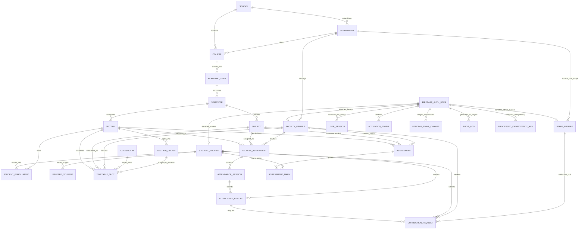

# 6. Data and Architecture Requirements

**Version:** 2.2.0 — Multi-School Academic Hierarchy, Master Timetable Management & Conflict Engine, Real-Life Double-Submission Defense, Complete Role-Based Access Control, and Comprehensive Automated QA Release  
**Date:** 24 October 2026  
**Status:** Implemented & Verified in Codebase (217+ Automated Tests Passing — 100% Pass Rate)

---

## 6.1 Academic Hierarchy and Identity Architecture

The data architecture is structured around the required 7-tier institutional hierarchy, integrated with a secure role-based identity, session management, timetable scheduling, examination marks governance, and attendance correction lifecycle subsystem built entirely on **Google Firebase and Google Cloud Platform (GCP)**:

```
School / Constituent College -> Department -> Course / Programme -> Academic Year -> Semester -> Section -> Practical Subgroups (C1/C2) -> Students
```

The architecture enforces strict separation between authentication credentials (managed by **Firebase Authentication**), role-specific profile attributes, departmental scoping for HODs (enforced via server-side database checks and PostgreSQL Row-Level Security), academic curriculum definitions, enrollment progression, granular per-device session state management, immutable attendance registers, and continuous assessment marks.

**Technology Mandate:** All data persistence, serverless compute, background queueing, and media storage are hosted exclusively on Google Cloud Platform and Firebase. AWS services are strictly excluded.



---

## 6.2 Relational Database Schemas (Cloud SQL PostgreSQL)

### 1. Multi-School & Academic Entities
```sql
CREATE TABLE schools (
    school_id UUID PRIMARY KEY DEFAULT gen_random_uuid(),
    school_code VARCHAR(20) UNIQUE NOT NULL,
    school_name VARCHAR(255) NOT NULL,
    description TEXT,
    dean_name VARCHAR(150),
    contact_email VARCHAR(255),
    is_active BOOLEAN DEFAULT TRUE,
    created_at TIMESTAMPTZ DEFAULT NOW(),
    updated_at TIMESTAMPTZ DEFAULT NOW()
);

CREATE TABLE departments (
    department_id UUID PRIMARY KEY DEFAULT gen_random_uuid(),
    school_id UUID REFERENCES schools(school_id) ON DELETE CASCADE,
    department_code VARCHAR(20) UNIQUE NOT NULL,
    department_name VARCHAR(255) NOT NULL,
    hod_name VARCHAR(150),
    hod_email VARCHAR(255),
    is_active BOOLEAN DEFAULT TRUE,
    created_at TIMESTAMPTZ DEFAULT NOW()
);

CREATE TABLE courses (
    course_id UUID PRIMARY KEY DEFAULT gen_random_uuid(),
    school_id UUID REFERENCES schools(school_id),
    department_id UUID REFERENCES departments(department_id) ON DELETE CASCADE,
    course_code VARCHAR(20) UNIQUE NOT NULL,
    course_name VARCHAR(255) NOT NULL,
    duration_years INT NOT NULL DEFAULT 3,
    total_semesters INT NOT NULL DEFAULT 6,
    is_active BOOLEAN DEFAULT TRUE,
    created_at TIMESTAMPTZ DEFAULT NOW()
);

CREATE TABLE semesters (
    semester_id UUID PRIMARY KEY DEFAULT gen_random_uuid(),
    course_id UUID REFERENCES courses(course_id) ON DELETE CASCADE,
    semester_number INT NOT NULL,
    academic_year VARCHAR(20) NOT NULL,
    term VARCHAR(20) NOT NULL, -- 'Autumn', 'Spring'
    is_active BOOLEAN DEFAULT TRUE,
    UNIQUE(course_id, semester_number, academic_year, term)
);

CREATE TABLE sections (
    section_id UUID PRIMARY KEY DEFAULT gen_random_uuid(),
    semester_id UUID REFERENCES semesters(semester_id) ON DELETE CASCADE,
    section_name VARCHAR(10) NOT NULL, -- 'A', 'B', 'C', 'D'
    max_capacity INT NOT NULL DEFAULT 80 CHECK (max_capacity BETWEEN 10 AND 120),
    room_number VARCHAR(50),
    created_at TIMESTAMPTZ DEFAULT NOW(),
    UNIQUE(semester_id, section_name)
);

CREATE TABLE section_groups (
    group_id UUID PRIMARY KEY DEFAULT gen_random_uuid(),
    section_id UUID REFERENCES sections(section_id) ON DELETE CASCADE,
    group_code VARCHAR(10) NOT NULL, -- 'C1', 'C2'
    group_name VARCHAR(100) NOT NULL,
    created_at TIMESTAMPTZ DEFAULT NOW(),
    UNIQUE(section_id, group_code)
);

CREATE TABLE classrooms (
    room_id UUID PRIMARY KEY DEFAULT gen_random_uuid(),
    room_code VARCHAR(30) UNIQUE NOT NULL, -- 'LH-201', 'LAB-3'
    room_name VARCHAR(100) NOT NULL,
    room_type VARCHAR(50) NOT NULL, -- 'LECTURE_HALL', 'COMPUTER_LAB', 'SEMINAR_ROOM'
    capacity INT NOT NULL DEFAULT 60,
    building VARCHAR(100),
    floor VARCHAR(20),
    is_active BOOLEAN DEFAULT TRUE,
    created_at TIMESTAMPTZ DEFAULT NOW()
);
```

### 2. Timetable Management Schema
```sql
CREATE TABLE timetable_slots (
    slot_id UUID PRIMARY KEY DEFAULT gen_random_uuid(),
    section_id UUID REFERENCES sections(section_id) ON DELETE CASCADE,
    group_id UUID REFERENCES section_groups(group_id) ON DELETE SET NULL, -- NULL for Whole Section
    subject_id UUID REFERENCES subjects(subject_id) ON DELETE RESTRICT,
    teacher_id UUID REFERENCES faculty_profiles(faculty_profile_id) ON DELETE RESTRICT,
    room_id UUID REFERENCES classrooms(room_id) ON DELETE RESTRICT,
    day_of_week VARCHAR(15) NOT NULL, -- 'MONDAY'..'SATURDAY'
    start_time TIME NOT NULL,
    end_time TIME NOT NULL,
    session_type VARCHAR(20) NOT NULL, -- 'LECTURE', 'PRACTICAL_LAB', 'TUTORIAL'
    academic_term VARCHAR(30) NOT NULL,
    created_at TIMESTAMPTZ DEFAULT NOW(),
    updated_at TIMESTAMPTZ DEFAULT NOW(),
    CONSTRAINT valid_time_interval CHECK (end_time > start_time)
);
```

### 3. Student Enrollment & Deletion Persistence
```sql
CREATE TABLE student_profiles (
    student_profile_id UUID PRIMARY KEY DEFAULT gen_random_uuid(),
    user_uid VARCHAR(128) UNIQUE NOT NULL,
    student_id VARCHAR(50) UNIQUE NOT NULL,
    enrollment_no VARCHAR(50),
    registration_no VARCHAR(50),
    school_id UUID REFERENCES schools(school_id),
    full_name VARCHAR(255) NOT NULL,
    student_gmail VARCHAR(255) UNIQUE NOT NULL,
    current_course_id UUID REFERENCES courses(course_id),
    phone_number VARCHAR(20),
    parent_guardian_contact VARCHAR(20),
    blood_group VARCHAR(5),
    account_status VARCHAR(30) DEFAULT 'PENDING_ACTIVATION', -- 'PENDING_ACTIVATION', 'ACTIVE', 'SUSPENDED'
    created_at TIMESTAMPTZ DEFAULT NOW()
);

CREATE TABLE student_enrollments (
    enrollment_id UUID PRIMARY KEY DEFAULT gen_random_uuid(),
    student_profile_id UUID REFERENCES student_profiles(student_profile_id) ON DELETE CASCADE,
    section_id UUID REFERENCES sections(section_id) ON DELETE RESTRICT,
    roll_number INT NOT NULL,
    status VARCHAR(20) DEFAULT 'ACTIVE', -- 'ACTIVE', 'TRANSFERRED', 'COMPLETED', 'WITHDRAWN'
    effective_from TIMESTAMPTZ DEFAULT NOW(),
    effective_to TIMESTAMPTZ,
    UNIQUE(section_id, roll_number)
);

-- Tracks permanently deleted students to guarantee zero resurrection across resets
CREATE TABLE deleted_students (
    student_id VARCHAR(50) PRIMARY KEY,
    deleted_at TIMESTAMPTZ DEFAULT NOW(),
    deleted_by VARCHAR(128)
);
```

### 4. Live Attendance & Dynamic QR Attendance
```sql
CREATE TABLE attendance_sessions (
    session_id UUID PRIMARY KEY DEFAULT gen_random_uuid(),
    faculty_assignment_id UUID REFERENCES faculty_assignments(assignment_id) ON DELETE RESTRICT,
    session_date DATE NOT NULL,
    start_time TIME NOT NULL,
    end_time TIME NOT NULL,
    instructional_hours INT NOT NULL DEFAULT 1,
    status VARCHAR(20) DEFAULT 'DRAFT', -- 'DRAFT', 'LOCKED', 'MODIFIED_AUDITED'
    qr_active_token VARCHAR(256),
    qr_token_expires_at TIMESTAMPTZ,
    created_at TIMESTAMPTZ DEFAULT NOW(),
    locked_at TIMESTAMPTZ,
    UNIQUE(faculty_assignment_id, session_date, start_time)
);

CREATE TABLE attendance_records (
    record_id UUID PRIMARY KEY DEFAULT gen_random_uuid(),
    session_id UUID REFERENCES attendance_sessions(session_id) ON DELETE CASCADE,
    student_profile_id UUID REFERENCES student_profiles(student_profile_id) ON DELETE RESTRICT,
    status VARCHAR(5) NOT NULL, -- 'P', 'A', 'L'
    check_in_mode VARCHAR(20) DEFAULT 'ROLL_CALL', -- 'ROLL_CALL', 'QR_SCAN', 'ADMIN_ADJUSTMENT'
    created_at TIMESTAMPTZ DEFAULT NOW(),
    updated_at TIMESTAMPTZ DEFAULT NOW(),
    UNIQUE(session_id, student_profile_id)
);
```

### 5. Examination Marks Governance Schema
```sql
CREATE TABLE assessments (
    assessment_id UUID PRIMARY KEY DEFAULT gen_random_uuid(),
    section_id UUID REFERENCES sections(section_id) ON DELETE RESTRICT,
    subject_id UUID REFERENCES subjects(subject_id) ON DELETE RESTRICT,
    faculty_profile_id UUID REFERENCES faculty_profiles(faculty_profile_id) ON DELETE RESTRICT,
    assessment_name VARCHAR(150) NOT NULL, -- 'Continuous Internal Assessment 1'
    assessment_type VARCHAR(50) NOT NULL, -- 'CIA', 'MID_TERM_THEORY', 'PRACTICAL_VIVA', 'END_SEM_THEORY'
    max_marks NUMERIC(5,2) NOT NULL CHECK (max_marks > 0),
    weightage_percent NUMERIC(5,2) DEFAULT 0,
    assessment_date DATE NOT NULL,
    status VARCHAR(20) DEFAULT 'DRAFT', -- 'DRAFT', 'SUBMITTED', 'PUBLISHED'
    submitted_at TIMESTAMPTZ,
    published_at TIMESTAMPTZ,
    created_at TIMESTAMPTZ DEFAULT NOW(),
    UNIQUE(section_id, subject_id, assessment_name)
);

CREATE TABLE assessment_marks (
    mark_id UUID PRIMARY KEY DEFAULT gen_random_uuid(),
    assessment_id UUID REFERENCES assessments(assessment_id) ON DELETE CASCADE,
    student_profile_id UUID REFERENCES student_profiles(student_profile_id) ON DELETE RESTRICT,
    marks_obtained NUMERIC(5,2) NOT NULL CHECK (marks_obtained >= 0),
    attendance_status VARCHAR(20) DEFAULT 'PRESENT', -- 'PRESENT', 'ABSENT', 'EXEMPT'
    entered_by UUID REFERENCES faculty_profiles(faculty_profile_id),
    created_at TIMESTAMPTZ DEFAULT NOW(),
    updated_at TIMESTAMPTZ DEFAULT NOW(),
    UNIQUE(assessment_id, student_profile_id)
);
```

### 6. Linear SHA-256 Cryptographic Audit Chain Schema
```sql
CREATE TABLE audit_logs (
    audit_id UUID PRIMARY KEY DEFAULT gen_random_uuid(),
    block_height BIGSERIAL UNIQUE NOT NULL,
    actor_uid VARCHAR(128) NOT NULL,
    actor_email VARCHAR(255) NOT NULL,
    actor_role VARCHAR(50) NOT NULL,
    action_type VARCHAR(100) NOT NULL,
    target_entity VARCHAR(100) NOT NULL,
    target_entity_id VARCHAR(128) NOT NULL,
    previous_state JSONB,
    new_state JSONB,
    client_ip VARCHAR(45) NOT NULL,
    user_agent TEXT,
    timestamp TIMESTAMPTZ DEFAULT NOW(),
    previous_block_hash VARCHAR(64) NOT NULL,
    block_hash VARCHAR(64) NOT NULL
);
```

---

## 6.3 Real-Life Double-Submission Defense & Idempotency Architecture

To prevent concurrency hazards and duplicate entries in high-traffic administrative operations, the system enforces multi-layered idempotency:

1. **Academic Entity Duplicate Defense:**
   - Pre-check across normalized codes (`department_code`, `course_code`, `room_code`, `group_code`).
   - If an entity exists with identical identifying attributes, the system idempotently returns the existing entity without generating redundant ghost rows.
2. **Attendance Session Creation Idempotency:**
   - Double-clicking "Take Attendance" evaluates `(assignment_id, session_date, start_time)`.
   - Returns the active draft session idempotently with 0 duplicate sessions created.
3. **Assessment Provisioning Double-Click Defense:**
   - Assessment creation enforces uniqueness on `(section_id, subject_id, assessment_name)`.
   - Rapid double-clicks return the existing assessment draft idempotently.
4. **Marks Bulk Score Atomic Upsert:**
   - Score re-submissions execute an atomic upsert on `(assessment_id, student_profile_id)`, updating existing scores without generating duplicate score records.
5. **Validation Guardrails:**
   - Score boundaries ($0 \le \text{marksObtained} \le \text{maxMarks}$) are verified server-side on every mark input.

---

## 6.4 Measurable Latency SLAs under Concurrent Workloads

| Operation / Query | Target p95 Latency SLA | Target p99 Latency SLA | Workload Conditions |
| :--- | :--- | :--- | :--- |
| **Student Dashboard Aggregate Rollup** | $< 50\text{ ms}$ | $< 100\text{ ms}$ | 500 concurrent Virtual Users (VUs) |
| **Section Roster Loading (80 students)** | $< 150\text{ ms}$ | $< 250\text{ ms}$ | 100 concurrent VUs |
| **Attendance Register Submission (Atomic Commit)** | $< 250\text{ ms}$ | $< 500\text{ ms}$ | 70 concurrent faculty submissions |
| **Bulk Import Validation (4,165 records)** | $< 5\text{ seconds}$ | $< 10\text{ seconds}$ | Single batch stream, RAM < 128 MB |
| **Timetable Conflict Evaluation Query** | $< 80\text{ ms}$ | $< 150\text{ ms}$ | 50 concurrent schedule modifications |
| **Audit Log Inspection Query (Admin / HOD)** | $< 200\text{ ms}$ | $< 400\text{ ms}$ | 50 concurrent administrative queries |

---

## 6.5 Dual-Mode Backend Execution Architecture

The system operates seamlessly in two environments:
1. **Production Mode (Cloud Run + Cloud SQL PostgreSQL):**
   - Connects to Google Cloud SQL PostgreSQL via unix socket or Cloud SQL Proxy.
   - Leverages PgBouncer connection pooling and Row-Level Security (`SET LOCAL`).
2. **Local Development / Offline Mode (Stateful In-Memory Repository):**
   - Auto-initializes state from [`backend/db/seed.sql`](file:///u:/attendance%20app/backend/db/seed.sql) when PostgreSQL is unavailable.
   - Supports 100% of all REST APIs, conflict detection engines, audit chains, and automated test suites without requiring external database services.
